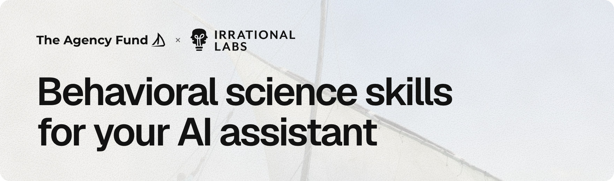
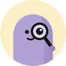

<p align="center">
  <a href="https://besci-skills.vercel.app">
    <picture>
      <source media="(prefers-color-scheme: dark)" srcset=".github/assets/banner-dark.jpg">
      
    </picture>
  </a>
</p>

<p align="center">
  An open-source library of atomic AI skills that bring actionable behavioral-science methods into your everyday work.
</p>

<p align="center">
  <a href="https://besci-skills.vercel.app/skills/"><b>Browse skills</b></a>&emsp;
  <a href="https://besci-skills.vercel.app/map/"><b>Skill map</b></a>&emsp;
  <a href="https://besci-skills.vercel.app/workflows/"><b>Workflows</b></a>&emsp;
  <a href="https://besci-skills.vercel.app/install/"><b>Install</b></a>&emsp;
  <a href="https://besci-skills.vercel.app/contribute/"><b>Contribute</b></a>&emsp;
  <a href="https://besci-skills.vercel.app/about/"><b>About</b></a>
</p>

<p align="center">
  <a href="https://github.com/agency-fund/besci-skills/actions/workflows/ci.yml"></a>
  <a href="LICENSE-CONTENT.md"></a>
  <a href="LICENSE"></a>
  <a href="https://agentskills.io"></a>
</p>

---

The Behavioral Science Skills Library is a free, open-source set of AI skills for people who want to practice behavioral science with the help of AI in their daily work. Each skill covers one method, like a COM-B barrier analysis or a cognitive interview script. It asks about your situation before it produces anything, names the evidence it is built on, and says when to bring in a specialist. The first skills and workflows were co-developed by [The Agency Fund](https://agency.fund) and [Irrational Labs](https://irrationallabs.com).

## Why we built this

Imagine a researcher or a practitioner at an NGO running a large program in a low- or middle-income country. The next phase starts in six weeks. They want to draw on behavioral science in their intervention design, but don't have months to read across disciplines, chase down papers behind paywalls, or consult an expert every time a new question comes up.

Part of the problem is that the knowledge is scattered. Similar ideas appear under different names across psychology, economics, education, public health, and other fields. We don't think everyone needs to agree on one grand theory of human behavior. But at the level of practical tasks, there is a lot we can share: defining a target behavior, identifying barriers, choosing an intervention technique, designing a measure, or planning a test.

Today's AI is useful for applying these methods, and it goes astray easily without proper guidance. So we're turning common methods into small, structured, reusable skills that an AI assistant can work through with you. We're taking an open-source approach because we don't think this library should belong to any one team or organization. [Read the full story on the About page.](https://besci-skills.vercel.app/about/)

## Who it is for

In the social sector, having a behavioral scientist in the room is a luxury, and most organizations have never had one. We built the library for the people who carry that line of work in their teams, so they can do more of it themselves and know when to bring in a specialist. It is built for four kinds of people:

<table>
  <tr>
    <td align="center" valign="top" width="25%"><br><b>Learners</b><br><sub>People in the public who want to learn about behavioral science.</sub></td>
    <td align="center" valign="top" width="25%"><br><b>Practitioners</b><br><sub>Program designers, product managers, designers, and others who practice behavioral science in their work without formal training in it.</sub></td>
    <td align="center" valign="top" width="25%"><br><b>Industry researchers</b><br><sub>UX researchers, M&amp;E researchers, and others who use behavioral science in their research without having formally studied it.</sub></td>
    <td align="center" valign="top" width="25%"><br><b>Experts</b><br><sub>Behavioral scientists and academic scholars whose job is to study and practice behavioral science.</sub></td>
  </tr>
</table>

## What it looks like

You describe your problem. The navigator asks what it needs to know, then recommends skills in order.

> **You:** How do I measure agency in my program?
>
> **`besci-navigator`:** Your goal is still open, so I'm in guide mode: a few questions first, one at a time. What does the program do, for whom, and what would more agency look like?
>
> **You:** We run a voice advisory line for smallholder farmers in Ethiopia. We want farmers to make their own planting decisions with confidence, not just follow the advice.
>
> **`besci-navigator`:** Has your team written down what agency means for these farmers, and what data do you collect now?
>
> **You:** No definition yet. We have call logs, and a household survey at baseline in March.
>
> **`besci-navigator`:** That is enough to recommend skills. Switching to route mode: three skills, in this order:
>
> 1. **Define:** [`define-agency-construct`](https://besci-skills.vercel.app/skills/define-agency-construct/). Nobody has written down what agency means for these farmers, and measures chosen before that measure "agency" in name only.
> 2. **Measure:** [`plan-agency-measurement`](https://besci-skills.vercel.app/skills/plan-agency-measurement/). Turns the definition into measures in the calls and outside them. Your call logs already count as data.
> 3. **Measure:** [`draft-survey-items`](https://besci-skills.vercel.app/skills/draft-survey-items/). Writes the baseline questions so farmers with little schooling can answer them when an enumerator reads them aloud.

<sub>Example conversation, shortened. The program is made up. The <a href="https://besci-skills.vercel.app">home page</a> plays this and two more.</sub>

## Install

Every option installs the same skills. Only Claude Code updates them for you.

**Claude Code** (recommended). Two commands install every skill and keep them up to date:

```
/plugin marketplace add agency-fund/besci-skills
/plugin install besci-skills@besci-skills
```

Then describe what you're working on. The navigator answers behavioral-science questions, and a skill runs when you name its method. Type `/besci-navigator` to call the navigator directly.

<details>
<summary><b>Codex, Cursor, Copilot, Gemini CLI, OpenCode, and more</b></summary>
<br>

The `skills` CLI reads this repository's plugin manifest and installs into whichever agents it finds.

```
npx skills add agency-fund/besci-skills --all
```

Or just the two meta-skills:

```
npx skills add agency-fund/besci-skills --skill besci-navigator --skill besci-eval
```

Update with `npx skills update`.

</details>

<details>
<summary><b>Claude Desktop and claude.ai</b> (no terminal)</summary>
<br>

1. Open the skill's page in the [catalog](https://besci-skills.vercel.app/skills/) and click **Download &lt;name&gt;.skill**. Start with [besci-navigator](https://besci-skills.vercel.app/skills/besci-navigator/) and [besci-eval](https://besci-skills.vercel.app/skills/besci-eval/).
2. In Claude, open **Settings → Capabilities → Skills → Upload skill** and choose the file.
3. Enable it, then ask Claude to do the thing the skill does.

Zip installs do not update themselves. Watch [What's new](https://besci-skills.vercel.app/whats-new/) or the [RSS feed](https://besci-skills.vercel.app/feed.xml) for releases, and re-upload to update.

</details>

> [!IMPORTANT]
> Using a skill inside a commercial AI product sends what you type to that product's provider. Do not paste sensitive personal or proprietary data without understanding the product's terms. Skills can also be read as an educational resource: learn the method and apply it in your own non-AI workflow. See [DISCLOSURE.md](DISCLOSURE.md).

## Where are you in the project?

Skills are grouped by the stage of a project where you'd use them. Each stage links to its skills in the catalog.

| Stage | What it covers | For example |
|---|---|---|
| [**Define**](https://besci-skills.vercel.app/skills/?stage=define) | Turn a goal, population, or outcome into something specific enough to work on. | [Turn a vague goal into one clear behavior](https://besci-skills.vercel.app/skills/define-key-behavior/)<br>[Write the causal chain from activities to outcome](https://besci-skills.vercel.app/skills/draft-theory-of-change/) |
| [**Diagnose**](https://besci-skills.vercel.app/skills/?stage=diagnose) | Explain why the current behavior pattern exists: barriers, drivers, context. | [Find out why people are not doing a behavior](https://besci-skills.vercel.app/skills/decompose-comb-barriers/)<br>[Find who already succeeds under the same constraints](https://besci-skills.vercel.app/skills/identify-positive-deviants/) |
| [**Design**](https://besci-skills.vercel.app/skills/?stage=design) | Produce intervention content, levers, messages, or strategy. | [Choose interventions for a confirmed barrier](https://besci-skills.vercel.app/skills/select-intervention-levers/)<br>[Plan when and how often to remind](https://besci-skills.vercel.app/skills/design-reminder-schedule/) |
| [**Measure**](https://besci-skills.vercel.app/skills/?stage=measure) | Choose, adapt, or build instruments for a behavior or construct. | [Write survey questions people can answer](https://besci-skills.vercel.app/skills/draft-survey-items/)<br>[Measure a sensitive behavior without asking directly](https://besci-skills.vercel.app/skills/design-list-experiment/) |
| [**Test**](https://besci-skills.vercel.app/skills/?stage=test) | Plan a pilot, experiment, or evaluation of an intervention. | [Design a pilot that tests feasibility, not effect](https://besci-skills.vercel.app/skills/design-pilot-feasibility-study/)<br>[Work out how big the sample must be](https://besci-skills.vercel.app/skills/estimate-sample-size/) |
| [**Analyze**](https://besci-skills.vercel.app/skills/?stage=analyze) | Analyze data from a test or evaluation and interpret the result. | [Turn interview transcripts into a barrier diagnosis](https://besci-skills.vercel.app/skills/synthesize-interview-findings/)<br>[Find out who benefited most from a program](https://besci-skills.vercel.app/skills/analyze-heterogeneous-effects/) |
| [**Implement**](https://besci-skills.vercel.app/skills/?stage=implement) | Roll out, adapt, or scale what worked, and report what was done. | [Plan how a tested program reaches routine delivery](https://besci-skills.vercel.app/skills/plan-scale-up-strategy/)<br>[Describe an intervention so others can replicate it](https://besci-skills.vercel.app/skills/draft-intervention-description/) |

Some skills produce something another skill takes in. A barrier diagnosis, for example, is what lever selection starts from. The [skill map](https://besci-skills.vercel.app/map/) draws these links for every skill.

## Workflows

A workflow runs several skills in order for a bigger job and marks where your team has to decide.

| Workflow | Who it is for |
|---|---|
| [From a vague goal to a piloted intervention](https://besci-skills.vercel.app/workflows/diagnose-to-pilot/) | A program team that has a goal ("more mothers complete antenatal care") and no behavioral diagnosis yet. |
| [Design, size, and test a reminder or message program](https://besci-skills.vercel.app/workflows/design-and-test-an-sms-program/) | A team that reaches people by SMS, voice, or WhatsApp and wants messages that move a behavior with a due date. |
| [Diagnose and shift a social norm](https://besci-skills.vercel.app/workflows/change-a-social-norm/) | A team working on a practice that a community keeps because each household expects the others to. |
| [Bring a survey instrument into a new language and mode](https://besci-skills.vercel.app/workflows/adapt-a-survey-instrument/) | A team that has a questionnaire in one language and setting and needs it to work in another. |

Pick skills on the site to [build your own workflow](https://besci-skills.vercel.app/workflows/build/). It gives you the install command for just those skills. Workflow files live in [`workflows/`](workflows/).

## What's in a skill

A skill is a folder of instructions, scripts, and resources that an AI assistant loads when a task calls for it. Anthropic introduced the format for Claude, and it is now an [open standard](https://agentskills.io) that many other AI tools read. Until your request matches a skill, the assistant sees only its name and a short description. When it matches, the assistant loads the full instructions and follows them.

Our bar is higher than a good prompt. A skill covers one method. It asks about your situation before it produces anything. It names the framework or evidence it is built on, and how far that evidence has been tested outside WEIRD (Western, Educated, Industrialized, Rich, and Democratic) samples. It says when not to use it, how it tends to go wrong, and when to bring in a specialist. Its output follows a fixed template. And it carries a version number and a changelog, so a project can cite exactly what it used.

```
skills/decompose-comb-barriers/
├── SKILL.md          trigger rule, stage, version, WEIRD status,
│                     then eight fixed sections, from "What it
│                     does" to "When to bring in a specialist"
├── evals/evals.json  realistic prompts + expected output shape
├── CHANGELOG.md      one entry per version
└── references/       optional detail, loaded on demand
```

**The rule for scope:** one thing a behavioral scientist does, narrow enough to say in one sentence without "and". If your sentence needs an "and", you have two skills, and the second usually takes the first one's output.

| Atomic | Too broad |
|---|---|
| Decompose a defined behavior into COM-B barrier hypotheses | Design a behavior change program |
| Draft a saying-is-believing exercise for a target population | Apply behavioral science to a chatbot |
| Design a measure of user agency using Social Cognitive Theory | Analyze this program and tell me what's wrong |

The full contract is in [the skill spec](docs/skill-spec.md). A validator enforces it in CI, on upload, and inside the creator skill.

## Meta-skills for using the library

If you don't know which skill you need, start with the navigator. To examine how good a particular skill is, use the evaluator. To create a new skill, use the skill creator.

- **[`besci-navigator`](https://besci-skills.vercel.app/skills/besci-navigator/)** recommends which library skills to run, in what order, for the problem a user describes.
- **[`besci-eval`](https://besci-skills.vercel.app/skills/besci-eval/)** runs three checks on one library skill: structure, triggering, output quality.
- **[`besci-skill-creator`](https://besci-skills.vercel.app/skills/besci-skill-creator/)** interviews an author about one behavioral-science method until every part of a library skill is clear, then drafts the complete skill folder.

## Principles

We expect a fair question from people with concerns about AI as a medium for knowledge: *are you extracting expert judgment into a machine so that organizations can stop paying for experts?* These principles come from the memorandum of understanding between The Agency Fund and Irrational Labs. The [About page](https://besci-skills.vercel.app/about/) has each one in full.

| Principle | In the library |
|---|---|
| **Contributors can set their own terms.** | Authors are credited in the skill's metadata and changelog, including when a maintainer submits it for them. Deprecated skills stay in the history, so projects that cited them can still find them. |
| **Use of the library should follow open science guidelines.** | See [how to cite a skill](docs/citing.md), and use [`draft-sifa-declaration`](https://besci-skills.vercel.app/skills/draft-sifa-declaration/) to write the [SIFA](https://busara.global/our-works/the-sifa-tool-for-a-statement-of-intellectual-fellowship-and-accountability/) statement for your project. |
| **Skills do not replace experts.** | Every skill ends with "When to bring in a specialist", and the navigator checks those points before it recommends anything. |
| **Users and contributors need to be informed about what may be shared with AI providers.** | The [disclosure](DISCLOSURE.md) spells this out, and every skill can be read on the site without installing anything. |

## Contribute

A skill covers one method, narrow enough to describe in a sentence without the word "and". For now, contributions come from staff at The Agency Fund and Irrational Labs while we test the process on our own work; invited experts join in 2027.

1. **Claim or propose.** Check the [catalog](https://besci-skills.vercel.app/skills/) for something that already covers it, then [propose the skill](https://besci-skills.vercel.app/propose/). A maintainer confirms it is atomic before you write it.
2. **Draft it with `besci-skill-creator`.** Say "I want to create a skill for ...". It interviews you against the spec, drafts the whole folder, runs the validator, and packages a `.skill` file. Or copy [the template](template/skill-template/) and write by hand.
3. **Validate.** The same validator runs in the creator skill, in CI, and on upload:
   ```
   uv run scripts/besci_validate.py skills/<your-skill-name>
   ```
4. **Submit it.** Hand the `.skill` file to a maintainer, upload it with no git (the [upload form](https://besci-skills.vercel.app/upload/) or the [`inbox/`](inbox/) folder), or clone and open a pull request.
5. **Review.** A maintainer checks the content against the spec and approves the pull request. On merge the skill is marked `published` and appears on the site.

You can also review and rate skills already in the library from any skill's page, with no GitHub account. The full guide is in [CONTRIBUTING.md](CONTRIBUTING.md).

> [!NOTE]
> Your published skill content will be processed by third-party AI systems when others use it. You set your own terms for what goes in, and you can revise or deprecate your skill at any time. See [DISCLOSURE.md](DISCLOSURE.md).

## How it's run

The Agency Fund and Irrational Labs co-own the library, and neither can relicense, rename, or shut it down without the other. A maintainer reviews every skill before it is published, and the maintainers re-check published skills every quarter. Once a skill is live, anyone can rate it from its page, and staff at both organizations can file an expert review.

The library opens up in stages, from the two founding teams to anyone who wants to contribute:

| When | Stage |
|---|---|
| **Fall 2026 (now)** | **Build and test in-house.** The Agency Fund and Irrational Labs write the first skills and try the review process on their own work. |
| December 2026 | **Launch the first version.** The first library of skills goes public, with tutorials and webinars to help people start. |
| 2027 | **Co-build with experts.** Invited experts and applied organizations add their own skills and workflows, and rate the ones already here. |
| Later | **Open to everyone.** Anyone can propose a skill, and a wider coalition of behavioral science groups helps curate the library. |

A skill stays marked as a draft on the site until a maintainer has reviewed it. Roles and rules are in [GOVERNANCE.md](GOVERNANCE.md) and [MAINTAINERS.md](MAINTAINERS.md); conduct in [CODE_OF_CONDUCT.md](CODE_OF_CONDUCT.md).

## Cite

Each skill is a fixed, versioned artifact. Every skill page on the site has a ready-made "Cite this skill" block, and [docs/citing.md](docs/citing.md) covers workflows, open-science records, and SIFA statements. To cite the library as a whole, use GitHub's "Cite this repository" button, which reads [CITATION.cff](CITATION.cff).

## License

Skill content is [CC BY 4.0](LICENSE-CONTENT.md): you can use, adapt, and share a skill as long as you credit its authors. Code is [MIT](LICENSE).

<details>
<summary><b>Working in this repository</b></summary>
<br>

```
skills/            one folder per skill, atomic and meta
workflows/         workflow files and the template
template/          copy to start a new skill by hand
taxonomy.yaml      stages, verbs, input and output types, tags
docs/              skill spec, taxonomy, citing, deployment, expert reviews, analytics, adr/
scripts/           validator, site builder, catalog snapshot, packager, tests
site/src/          site assets; scripts/build_site.py builds the site into site/dist/
api/               the site's server functions on Vercel: upload, sign-in, reviews, ratings
inbox/             drop zone for .skill uploads through the GitHub website
.claude-plugin/    Claude Code marketplace and plugin manifests
.github/           CI, inbox unpacker, catalog snapshot, releases, issue and PR templates
```

Common commands, after `uv sync`:

```
uv run scripts/besci_validate.py        # check every skill
uv run scripts/check_sync.py            # bundled copies match their sources
uv run scripts/snapshot_catalog.py      # refresh the navigator's catalog
uv run scripts/build_site.py            # build the site into site/dist/
uv run scripts/package_skills.py        # build .skill zips into dist/
```

Vocabulary is in [CONTEXT.md](CONTEXT.md), decisions in [docs/adr/](docs/adr/), and operations in [docs/deployment.md](docs/deployment.md). AI agents working here should read [AGENTS.md](AGENTS.md) first.

</details>
